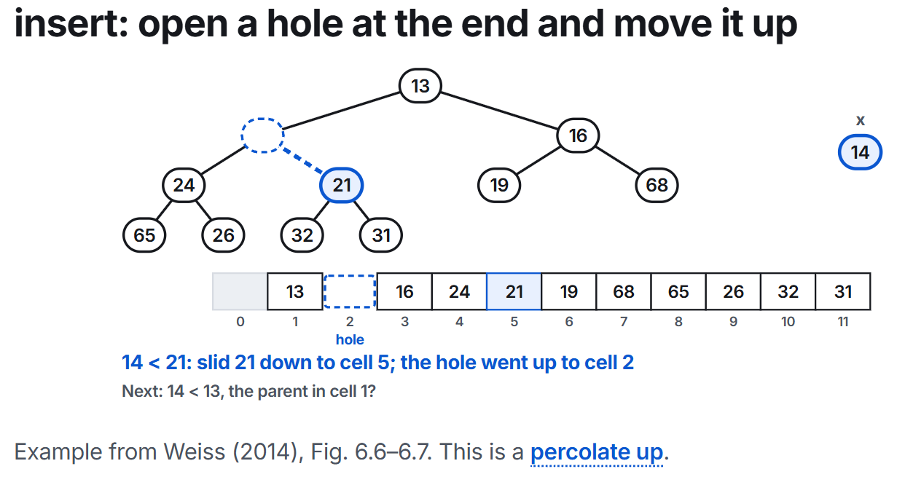

## Binary Heaps

### Priority queues

A priority queue serves the smallest key first, urgency is a number and the smaller the key it is more urgent. In a priority queue the smalles key leaves first, no matter when it arrived.

It has three basic operations:

| Operation       | What it does                                      |
|-----------------|---------------------------------------------------|
| `insert(x)`     | adds x                                            |
| `findMin()`     | returns the smallest element, without removing it |
| `deleteMin()`   | removes the smallest element                      |

The binary heap is the usual way to build a priority queue. It is a complete binary tree, which means that all levels are filled except possibly the last level, which is filled from left to right. Each node has a key, and the key of each node is less than or equal to the keys of its children (min-heap property).

The shape needs to be complete, so we can use an array to represent the tree. The root is at index 1, and for a node at index i, its left child is at index 2i and its right child is at index 2i + 1. The parent of a node at index i is at index floor(i/2) rounding down.

The order is that every parent is smaller than its children, so the smallest element is always at the root.

You can have a min-heap or a max-heap. In a min-heap, the smallest element is at the root, and in a max-heap, the largest element is at the root.

To insert an element, we add a hole at the end of the array and then "percolate up" checking if the parent is smaller than the current node.